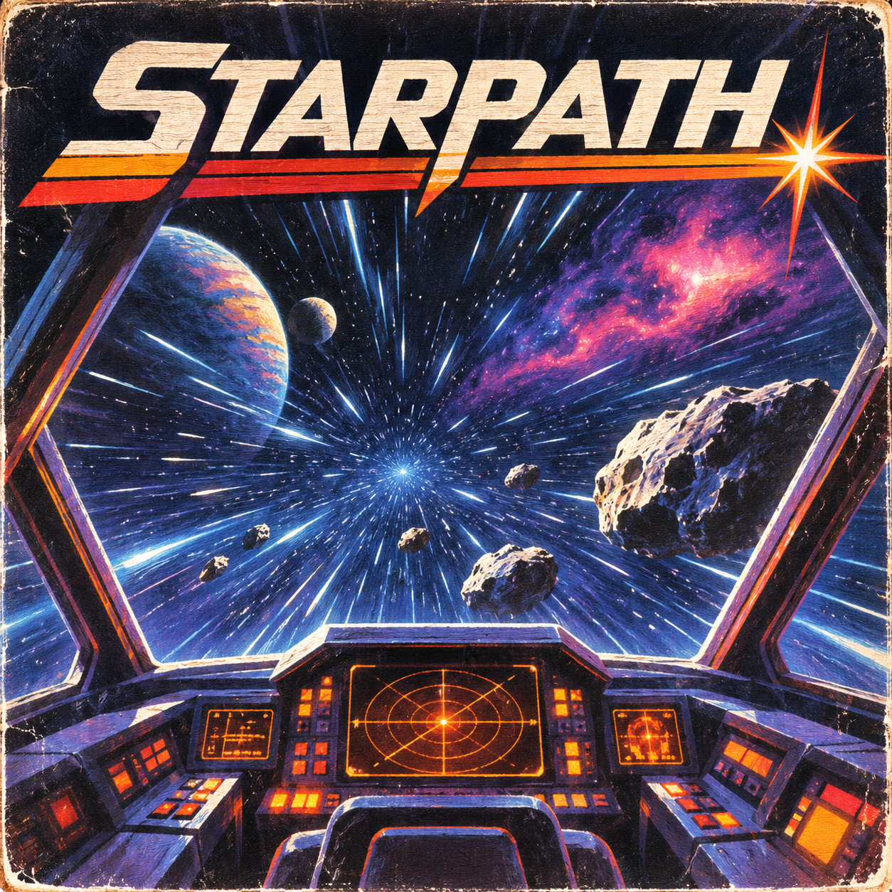

# Starpath

<p align="center">
  
</p>

Starpath is a continuous vector-granular spatial effect by **Monke Mountain Studios**. It captures live audio into a rolling memory and launches grains through a cockpit-like sound field: material approaches from the centre, Doppler-shifts, passes the listener on a unique heading, and dissolves into a modulated wake.

Starpath is designed as the linear-motion sister to Event Horizon. Instead of orbiting sound, it sends sound past you.

## Download

Prebuilt Windows and macOS packages are available from the [Releases page](https://github.com/Monkemountainstudios/StarPath/releases).

Supported formats:

- Windows x64: VST3 and Standalone
- macOS Universal: VST3, Audio Unit, and Standalone

## Quick start

1. Insert Starpath on an audio track or bus.
2. Begin with the built-in **Factory Preset**.
3. Raise **Traffic** for more events and use **Warp** to set the typical flyby speed.
4. Move **Mass** toward larger grains for sustained material or toward smaller grains for particulate textures.
5. Increase **Shield** to intercept a percentage of incoming grains and generate spectral impact ghosts.
6. Use **Mix** to blend the original signal with Starpath.

Starpath uses probability rather than rigid repetition. Controls establish ranges and biases, while individual grains retain variation and occasional rare events.

## Control manual

| Control | Function |
|---|---|
| **Warp** | Sets the typical transit speed. Rare slow drifters and fast streaks can still occur. |
| **Traffic** | Controls the average grain-launch density, including natural clusters and gaps. |
| **Mass** | Biases the population toward small or large grains without completely excluding either. Up to two rare long “comet” grains may appear. |
| **Trajectory** | Biases grains toward distant passes or close, dramatic flybys. |
| **Scatter** | Widens variation in timing, speed, heading, pitch, and filtering. |
| **Doppler** | Sets flyby pitch motion. Most of the range is restrained and musical; the upper region allows more extreme motion. |
| **Dust / Void** | Bipolar departure filter. Lower values recede into dark low-pass **Void**; higher values disintegrate into high-pass **Dust**. |
| **Wake** | Adds chorus and a long cross-coupled receding trail. At maximum, the tail can persist for tens of seconds. |
| **Atmosphere** | Adds the persistent diffuse reverb that binds separate events into a shared space. |
| **Shield** | Sets interception probability and field size. At 50%, roughly half of eligible grains pass normally while half are deflected. Above 30%, Shield also introduces a quiet 700–1200 ms delay. |
| **Impact** | Controls the level and persistence of delayed spectral ghosts produced by Shield collisions. |
| **Mix** | Equal-power dry/wet blend. |

### Grain behavior

Every grain receives a 360-degree viewport heading and a complete life cycle: approach, closest point, departure, and wake. The population includes sustained, echo-pulsed, fluttering, reversed, and rare long grains. Stereo width begins narrow and expands near the listener.

### Shield behavior

Shield is probabilistic. Each eligible grain makes one collision decision when it reaches the field:

- Passing grains remain sonically and visually unaltered.
- Intercepted grains deflect, excite the phosphor field, and produce a consonant spectral ghost.
- At 100% Shield, every eligible grain is intercepted.

## Installation

### Windows

Copy `Starpath.vst3` to:

```text
C:\Program Files\Common Files\VST3
```

The standalone application is portable. For reliable low-latency operation, install and select the audio interface manufacturer’s ASIO driver rather than DirectSound.

### macOS

Copy the plug-ins to:

```text
VST3: /Library/Audio/Plug-Ins/VST3
AU:   /Library/Audio/Plug-Ins/Components
```

The automated macOS build is currently unsigned and unnotarized. macOS may require explicit approval before the first launch.

## Building from source

Starpath requires CMake 3.22+, a C++20 compiler, and JUCE 9.0.1.

```bash
git clone https://github.com/Monkemountainstudios/StarPath.git
cd StarPath
git clone --branch 9.0.1 --depth 1 https://github.com/juce-framework/JUCE.git
cmake -S . -B build -G Ninja -DCMAKE_BUILD_TYPE=Release -DSTARPATH_JUCE_SOURCE_DIR=JUCE
cmake --build build --parallel 3
ctest --test-dir build --output-on-failure
```

On macOS, pass `-DCMAKE_OSX_ARCHITECTURES="arm64;x86_64"` for a universal build.

## Credits

- Concept, product direction, sound design, and interface direction: **Monke Mountain Studios**
- Icon and visual concept artwork: **Astra**, directed by Monke Mountain Studios
- Engineering collaboration: **OpenAI Codex** with Monke Mountain Studios
- Framework: [JUCE](https://juce.com/)
- Starfield backdrop supplied by Monke Mountain Studios

Copyright © 2026 Monke Mountain Studios. All rights reserved.
